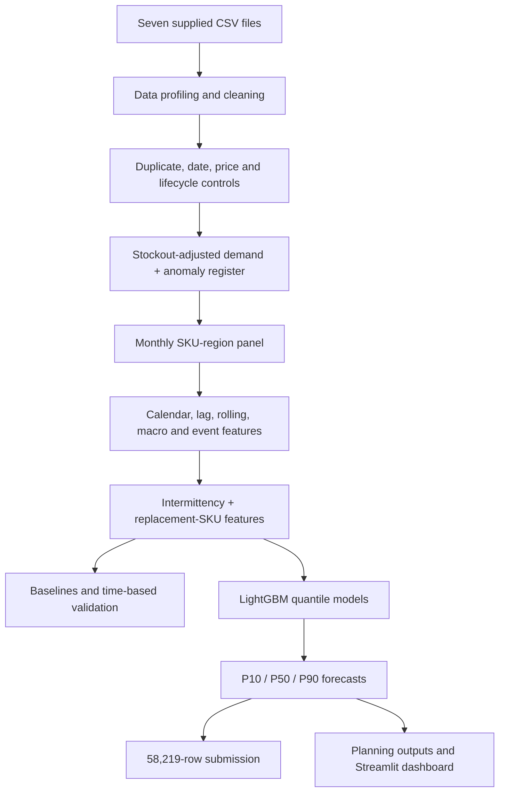

# Technical Report — Celeris Demand Forecasting & Planning Control Tower

## 1. Executive summary

This project turns the supplied ERP extract into a monthly demand-planning workflow for 600+ automotive/industrial SKUs across six regions. It delivers cleaned history, stockout-adjusted demand where evidence is available, an auditable anomaly register, global forecasting models, quantile forecast ranges, a planner dashboard and a complete test-row submission.

The final submission contains 58,219 non-negative integer forecasts for November 2026–May 2028. The output keys and row order match `test.csv` exactly. No duplicate keys, missing forecasts, negative values or quantile crossings were found in final QA.

## 2. Architecture

## 3. Data controls

- The delivery `Date` field is authoritative; `Year` and `Month` are regenerated from it.
- Duplicate transaction IDs keep the latest load timestamp. Remaining duplicate monthly SKU-region keys keep the latest loaded record.
- Blank descriptive attributes are filled from the SKU master when possible; text labels are trimmed.
- Negative sales targets are marked missing, never silently set to zero.
- For matching stockout keys, `Requested_Units` is used as the demand observation. This avoids training the demand model on supply-constrained shipments.
- Invalid unit prices are imputed using the SKU median, then family median. Clean revenue is recalculated.
- Out-of-lifecycle history is flagged and removed from the target. Future periods before launch and after EOL are constrained to zero.
- Missing monthly rows remain unknown in the history panel; they are not fabricated as zero orders.
- Events are activated only during their date range and within their declared scope.

## 4. Model design

A global LightGBM approach shares statistical strength across sparse SKU-region histories. Predictors include categorical SKU/region/family/business/customer/channel identifiers, monthly seasonality, trend, lags 1/2/3/6/12, rolling means and standard deviations, non-zero rate, macro indicators with 0–3 month offsets, scoped event flags, lifecycle age/EOL state, predecessor-SKU demand and intermittency descriptors (ADI/CV²).

Two transparent baselines are included: seasonal naive (lag 12) and recent 3-month mean. A Tweedie LightGBM is evaluated as the main point-forecast benchmark. Three additional LightGBM quantile regressors estimate P10, P50 and P90 for the future planning distribution. Quantile crossing is corrected by sorting the three outputs at each row.

## 5. Validation

| Evaluation | WAPE | Bias |
|---|---:|---:|
| Seasonal naive, one-step Nov 2025–Oct 2026 | 47.07% | +6.49% |
| Recent mean, one-step Nov 2025–Oct 2026 | 60.31% | −1.37% |
| LightGBM Tweedie, one-step Nov 2025–Oct 2026 | 37.60% | −1.72% |
| LightGBM Tweedie, fixed-origin 19-month holdout | 55.62% | −11.80% |

The fixed-origin test trains through March 2024 and predicts April 2024–October 2025 using lag state frozen at the origin. It is intentionally disclosed as one fixed-origin long-horizon holdout, not a full rolling-origin evaluation. The long-horizon error is materially higher than one-step error, so planners should review aggregate and SKU-level exceptions.

## 6. Dashboard

The Streamlit app includes all required views: executive overview, data health, demand explorer, anomaly monitor, and forecast/accuracy. Additional views include macro lead/lag diagnostics, P90 procurement planning, lifecycle exposure, stockout/lost-sales summary, planner exceptions and downloadable data. History and forecast are shown on a continuous timeline.

## 7. Interpretation and limitations

- P10/P50/P90 are quantile-regression estimates; nominal coverage has not been empirically calibrated by family, region or intermittency segment.
- Macro correlations are exploratory and must not be interpreted as causal effects.
- Forecast revenue uses the last observed SKU price; future annual price changes and surcharges are not projected.
- Procurement P90 is a demand proxy, not a purchase order. Lead time, MOQ, supplier constraints, safety stock and inventory on hand are not available in the supplied files.
- Anomaly flags are review candidates. Unusual demand may be a real customer event and should not be deleted without evidence.

## 8. Final quality assurance

The pipeline asserts that the submission has the same row count, keys and ordering as the cleaned test file; that all forecasts are non-negative; and that all P10/P50/P90 values are present and ordered. A separate final check confirmed 58,219 rows, 0 missing values, 0 negative forecasts, 0 duplicate keys, 0 quantile crossings, and the expected forecast date range.
